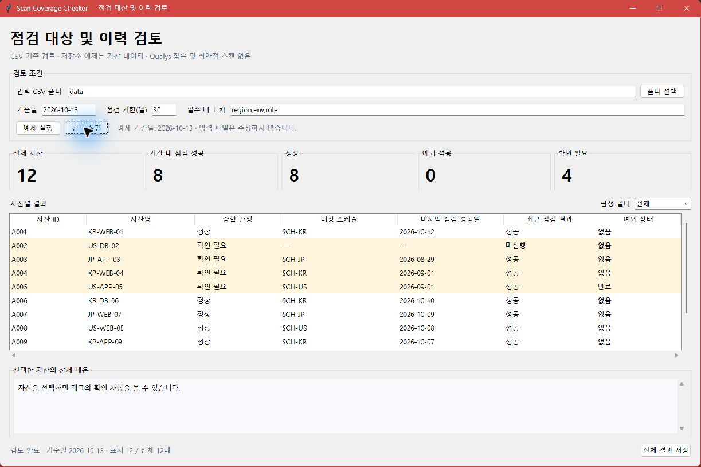
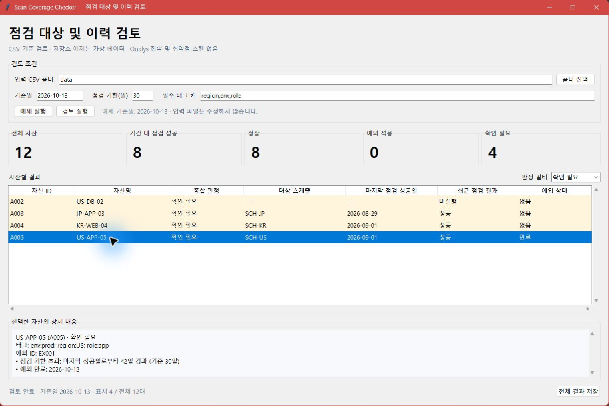

# Qualys Scan Coverage Checker

자산 목록과 점검 스케줄을 비교해 빠진 대상, 오래된 점검 이력, 만료된 예외를 찾는 Python 실습 도구입니다. Qualys의 태그 기반 대상 선정 방식을 참고했습니다.

예제 자산 12대와 점검·예외 이력은 모두 가상입니다. 실제 Qualys 계정이나 API에 연결하지 않으며 스캔을 실행하지 않습니다.

## 실행

Python 3.10 이상이 필요하며 표준 라이브러리만 사용합니다.

### GUI

저장소를 내려받은 뒤 프로젝트 폴더에서 실행합니다. Tkinter가 포함된 Python 환경이 필요합니다.

```powershell
python gui.py
```

1. **예제 실행**을 누르면 가상 자산 12대를 기준일 `2026-10-13`, 점검 기한 30일로 검토합니다. 정상 8대, 확인 필요 4대가 표시됩니다.
2. **판정 필터**에서 `확인 필요`를 선택하고 자산 행을 클릭합니다. 하단에서 필수 태그, 점검 기한 초과, 예외 만료 등 확인 사유를 조회합니다.
3. **전체 결과 저장**을 누르고 출력 폴더를 선택합니다. `summary.md`와 `findings.csv`가 저장되며, 기존 보고서가 있으면 덮어쓰기 여부를 확인합니다. 로컬 결과는 `reports/local/` 아래에 저장하세요.
4. 별도 입력을 검토하려면 **폴더 선택**으로 CSV 세 파일이 있는 폴더를 지정합니다. 기준일·점검 기한·필수 태그를 설정하고 **검토 실행**을 누릅니다. 파일 형식은 아래 [입력 CSV](#입력-csv)를 따릅니다.

입력 조건을 바꾸면 결과가 초기화되므로 검토를 다시 실행한 뒤 저장하세요. GUI와 CLI는 같은 CSV와 판정 함수를 사용하며, 결과는 실행 당시 읽은 자료를 기준으로 합니다.

필터는 화면에 표시할 행만 바꿉니다. `확인 필요`만 보고 있어도 보고서에는 전체 자산의 결과가 저장됩니다.

### 실행 화면

Windows에서 가상 CSV를 불러온 실행 화면입니다.

전체 결과: 자산 12대 중 정상 8대, 확인 필요 4대입니다.



상세 조회: 확인 대상 4대를 조회하고, 가상 자산 `US-APP-05`의 점검 기한 초과와 예외 만료 사유를 확인합니다.



### CLI

```powershell
python main.py --as-of 2026-10-13 --overwrite
```

```text
전체 12대 / 기간 내 점검 성공 8대 / 정상 8대 / 예외 적용 0대 / 확인 필요 4대
보고서 생성: summary.md, findings.csv
```

`--overwrite`는 저장소에 포함된 예제 보고서를 갱신할 때 사용합니다. 별도 폴더에 저장하려면 다음과 같이 실행합니다.

```powershell
python main.py --as-of 2026-10-13 --output-dir reports/local/run-01
```

기본 입력은 스크립트 폴더의 `data/`, 출력은 `reports/`입니다. 직접 지정한 상대 경로는 현재 작업 폴더를 기준으로 합니다. `--as-of`를 생략하면 실행 환경의 오늘 날짜로 판정합니다. Windows Python Launcher가 설정된 환경에서는 `python` 대신 `py -3`을 사용할 수 있습니다.

| 종료 코드 | 의미 |
| --- | --- |
| `0` | 보고서 생성 완료, 확인 대상 없음 |
| `1` | 보고서 생성 완료, 확인 대상 있음 |
| `2` | 입력 또는 저장 오류 |

예제 실행은 확인 대상 4대가 있어 `1`을 반환합니다.

### 테스트

```powershell
python -m unittest discover -s tests -v
```

GUI 창 테스트에는 데스크톱 화면 세션이 필요합니다. 화면 세션이 없는 환경에서는 해당 테스트를 건너뛰고 사유를 출력합니다.

## 점검 기준

| 확인 항목 | 판정 기준 |
| --- | --- |
| 필수 태그 | `region`, `env`, `role` 키 누락 |
| 점검 대상 누락 | 활성 스케줄의 포함·제외 조건을 적용한 뒤 매칭되는 스케줄 없음 |
| 점검 이력 | 마지막 성공일부터 30일 초과 또는 성공 이력 없음 |
| 최근 점검 결과 | 최근 점검 시도가 실패한 경우 |
| 예외 상태 | 승인되지 않았거나, 적용 시작 전이거나, 만료된 경우 |

태그의 `ANY`는 하나 이상, `ALL`은 모두 일치해야 합니다. 제외 조건이 일치하면 해당 스케줄의 대상에서 빠집니다. 태그는 대소문자를 구분하며, 정확히 30일이 지난 성공 이력은 기한 내로 판정합니다.

**스케줄 등록과 점검 성공은 따로 판정합니다.** 최근 성공 이력이 있어도 스케줄에서 빠졌거나 마지막 점검이 실패했다면 확인 대상입니다. CSV의 `success`는 해당 자산의 점검 성공을 뜻합니다. Qualys 작업 전체의 종료 상태를 그대로 옮기는 필드는 아닙니다.

승인 예외는 시작일부터 만료일 당일까지 유효합니다. 스케줄 누락·성공 이력 없음·점검 기한 초과에만 적용하고, 원래 확인 사항은 보고서에 남깁니다. 필수 태그 누락과 최근 점검 실패는 예외 대상에서 제외합니다. 실제로 예외를 적용한 항목이 없는 자산은 정상으로 집계합니다.

점검 기한과 필수 태그는 실행 옵션으로 변경할 수 있습니다.

```powershell
python main.py --as-of 2026-10-13 --stale-after-days 14 --required-tags region,env,role --output-dir reports/local/period-14
```

## 입력 CSV

UTF-8(선택적 BOM), 쉼표 구분, 헤더 필수입니다. 아래 열을 모두 사용해야 하며 추가 열은 허용하지 않습니다.

| 파일 | 열 | 주요 규칙 |
| --- | --- | --- |
| `assets.csv` | `asset_id`, `hostname`, `tags`, `last_successful_scan_date`, `latest_scan_status` | 최근 결과는 `success` / `failed` / `never` |
| `schedules.csv` | `schedule_id`, `enabled`, `include_tags`, `include_match`, `exclude_tags`, `exclude_match` | 활성 여부는 `true` / `false`, 매칭은 `ANY` / `ALL` |
| `exceptions.csv` | `exception_id`, `asset_id`, `approval_status`, `starts_on`, `expires_on` | 승인은 `approved` / `pending` / `rejected`, 자산당 예외 한 건 |

- 태그는 `region:KR;env:prod;role:web`처럼 작성합니다. 자산에는 키별로 하나의 값만 허용합니다. 스케줄의 포함 태그는 필수이고 제외 태그는 비워둘 수 있습니다.
- 날짜는 `YYYY-MM-DD`입니다. `success`는 성공일이 필수이고 `never`는 성공일이 비어 있어야 합니다. `failed`는 이전 성공일이 있을 수 있습니다.
- ID·hostname·태그 값은 영문 또는 숫자로 시작하는 최대 64자의 영문·숫자·`_`·`.`·`-`입니다. 태그 키는 소문자로 시작하는 최대 32자의 소문자·숫자·`_`입니다.
- 잘못된 날짜, 기준일 이후 성공일, 중복 ID, 없는 자산을 참조하는 예외, 시작일보다 빠른 만료일, 제어 문자는 오류로 처리합니다.
- 스케줄이나 예외가 없으면 헤더만 남깁니다. 자산은 한 대 이상 필요하며 입력 파일 세 개는 모두 있어야 합니다.

## 보고서

| 파일 | 내용 |
| --- | --- |
| [summary.md](reports/summary.md) | 전체 집계와 자산별 스케줄·점검 이력·예외·판정 |
| [findings.csv](reports/findings.csv) | 확인 사항별 상세 목록. 한 자산에 여러 행이 생길 수 있음 |

CSV의 `report_type=scan_coverage_check`는 점검 대상·이력 검토 결과라는 뜻입니다. `disposition=review`는 확인 대상, `waived`는 승인 예외를 적용한 항목입니다. 확인 사항이 없으면 헤더만 생성합니다.

전체 자산은 정상·예외 적용·확인 필요로 나눕니다. 기간 내 점검 성공 수는 마지막 성공일로 따로 계산합니다. 최근 시도가 실패했더라도 이전 성공일이 기한 안이면 이 수에 포함될 수 있습니다. 예외 승인은 성공 이력으로 세지 않습니다.

두 보고서는 순서대로 저장합니다. 저장 중 오류가 발생하면 일부 파일만 작성될 수 있으므로, 오류를 확인한 뒤 새 출력 폴더에서 재실행하세요.

## 적용 범위

참고 문서: Qualys의 [태그 포함·제외와 ANY/ALL](https://docs.qualys.com/en/vm/10.39.0.0/host_assets/using_asset_tags_basics.htm), [태그 기반 스캔 대상 지정](https://docs.qualys.com/en/vmdr/latest/scans/win_launch_scan.htm).

CSV 형식, 필수 태그, 30일 기준, 예외 처리 기준은 이 프로젝트에서 정한 규칙입니다. 태그 계층·동적 태그·IP 범위, 스케줄 주기·다음 실행일, 인증 점검 결과는 다루지 않습니다. 예외 승인은 CSV에 기록된 값을 사용하며, 승인 권한을 검증하는 기능은 없습니다. 실제 Qualys 내보내기 형식과의 호환성은 검증하지 않았습니다.

공개 예제에는 고객 정보, 운영 IP, 인증정보를 사용하지 않았습니다. 별도 입력을 사용하면 보고서에도 자산 ID와 hostname이 포함됩니다. 로컬 데이터는 `local-data/`, 로컬 보고서는 `reports/local/`에 저장하면 Git 추적 대상에서 제외됩니다. 공개 전에는 포함할 파일과 내용을 직접 확인해야 합니다.

라이선스: [MIT](LICENSE).
